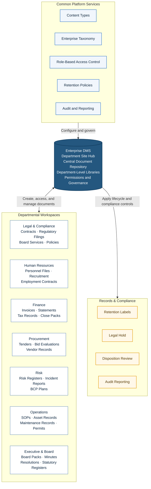

# Enterprise DMS Platform Architecture

This diagram shows the shared platform services governing the Enterprise Document Management System (DMS), departmental workspaces using the central repository, and records/compliance controls applied to managed content.

**Document flow:** Departments create and manage content in their workspaces. The central DMS provides the shared repository and permissions, using common platform services. Retention, legal hold, disposition, and audit controls govern records throughout their lifecycle.
