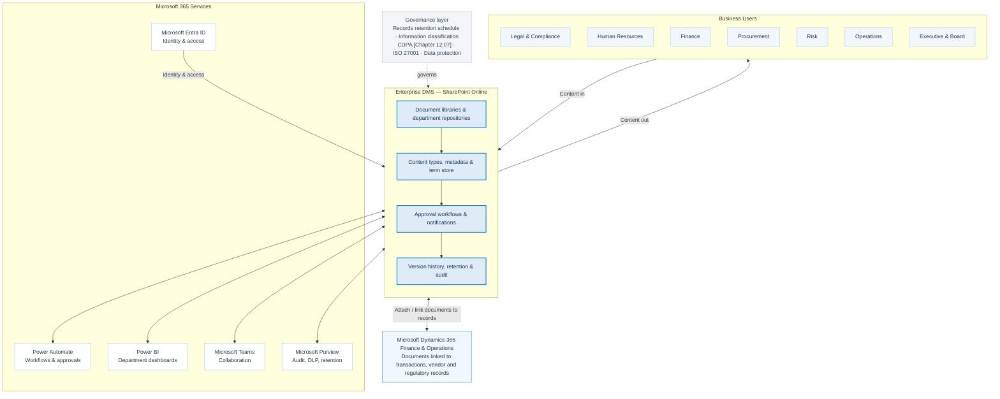

# Enterprise DMS — Microsoft 365 Architecture

This flow diagram represents the **second image**: business users work with a SharePoint Online-based Enterprise DMS, which connects to Microsoft 365 services and Microsoft Dynamics 365 Finance & Operations. Governance applies across the platform.

**Flow summary:** Business users send content to and retrieve content from the DMS. The SharePoint Online platform organizes documents in departmental repositories, applies metadata and workflow, and maintains version and retention records. Microsoft 365 services support automation, reporting, collaboration, compliance, and identity. Documents can be attached or linked to Dynamics 365 records. The governance layer applies across the architecture.
